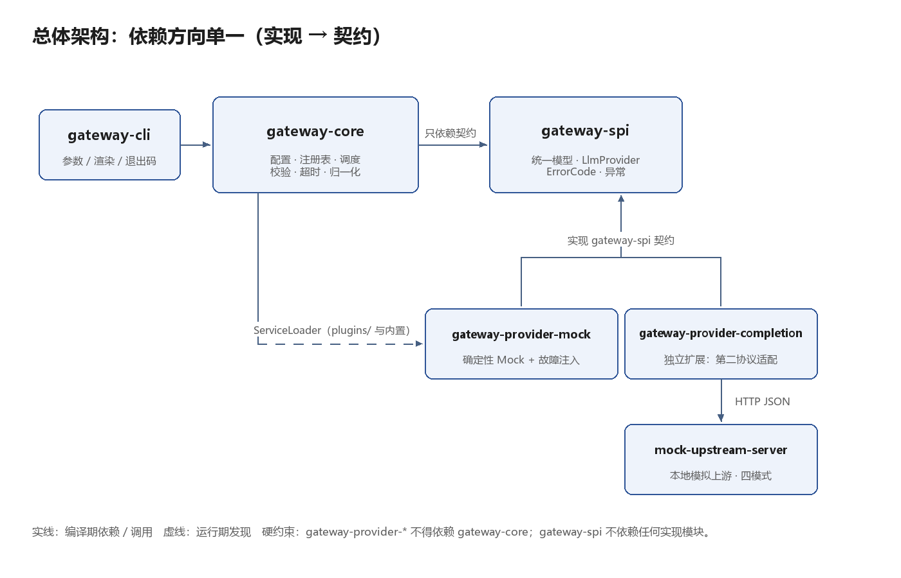
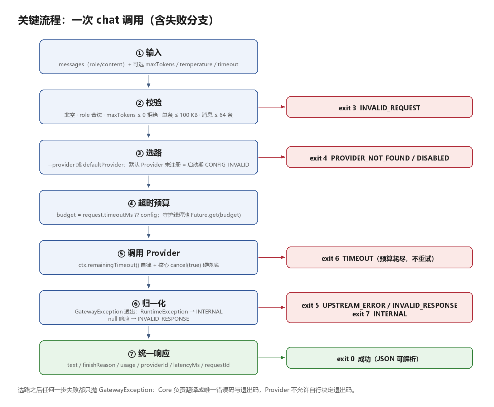

# LLM Provider Gateway 系统设计文档

> 版本 0.1.0 · 2026-11-26 · 组号 `GN`
>
> 本文描述 0.1.0 的设计：模块边界、公开契约、关键流程、数据与配置、测试方案，以及取舍与局限。

## 1. 项目概述与需求

### 1.1 目标用户与要解决的问题

用户是**写脚本和小工具的应用开发者**。他们需要在程序里调用大模型，但每家服务商的请求格式、错误码、超时行为都不一样：换一家就要改一遍调用代码，失败时也拿不到统一的、可判断的错误。

本项目提供一个命令行网关：调用者只写一种请求，由网关完成选路、协议转换和错误归一化。它不是聊天产品，也不提供模型能力本身。

### 1.2 核心使用场景

一句话：**应用开发者在脚本里用一条命令提交对话消息，由网关按配置选择 Provider、完成协议转换，拿到统一的文本结果与用量；Provider 不存在、超时或返回畸形数据时，得到明确的错误码而不是各家 SDK 的异常。**

核心场景的完成条件（同一台机器、不联网、按 README 三条命令可重复得到）：

1. 基础能力：调用内置 Mock，返回确定性结果，退出码 0；
2. 扩展能力：放入 `completion` 插件 JAR 后，同一条命令改走第二种协议，仍返回统一结构；
3. 失败反馈：上游超时或返回畸形 JSON 时，返回结构化错误与对应的非零退出码。

### 1.3 功能范围与边界

| 编号 | 功能 | 验收要点 |
| --- | --- | --- |
| FR-1 | `providers` 列出已发现的 Provider（id / 名称 / 能力 / 启用 / 版本） | 接入前 1 条、接入后 2 条；禁用后消失 |
| FR-2 | `chat` 统一调用：`--message` 或 `--request <json>`，`--provider` 可选 | 两种入参等价；缺省走 `defaultProvider` |
| FR-3 | 配置加载：YAML `config/gateway.yml`，`--config` 可覆盖 | 错误配置给 `CONFIG_INVALID` 与位置 |
| FR-4 | 请求校验：messages 非空、role 合法、maxTokens 为空或 >0、content 非空 | 非法输入 exit 3 + 字段级提示 |
| FR-5 | 错误归一化：8 个 `ErrorCode`，含 `retriable` | 每个 code 至少一条测试 |
| FR-6 | 超时：配置级默认 + 请求级覆盖，超时即 `TIMEOUT` 且不挂起进程 | 慢上游 3 秒内返回 exit 6 |
| FR-7 | 插件目录装配：启动扫 `plugins/*.jar`，`ServiceLoader` 发现 | 无插件目录也能启动；坏 JAR 跳过 |
| FR-8 | 输出：人类可读 + `--json` 机器可读 | `--json` 可被 `ConvertFrom-Json` 解析 |
| FR-9 | 内置 Mock：确定性回复 + 可配延迟与故障注入 | 同输入两次输出一致 |
| FR-10 | 独立扩展 `completion`：`messages→prompt`、`choices[0].text→text` | 字段级断言映射结果 |
| FR-11 | 本地模拟上游：独立可执行、端口可配、四模式 | 无网络即可演示四种模式 |

**明确不做**：HTTP 入口、流式（SSE）、多轮工具调用、插件热加载、多版本并行、真实模型 API 接入、计费、多租户、集群限流、复杂路由、管理后台、Docker/云部署。不做这些不影响核心场景的完整性，反而让「统一调用 + 可扩展」这条主线更清楚。

### 1.4 输入、输出与错误

- 输入：`messages`（`role` ∈ SYSTEM/USER/ASSISTANT，`content` 非空）+ 可选 `maxTokens`、`temperature`、`timeoutMs`；可选 `--provider` 指定，缺省走配置里的 `defaultProvider`。
- 输出：`text`、`finishReason`、`usage`、`providerId`、`latencyMs`、`requestId`。
- 错误：统一为 `GatewayException`，携带 `code`（8 个枚举之一）、`message`、`retriable`、`providerId`，由 CLI 映射到退出码 3–7。

## 2. 总体架构

### 2.1 模块与依赖方向



依赖方向只有一条：**实现 → 契约**。

- `gateway-spi` 是唯一被所有模块依赖的契约，不依赖任何实现模块；
- `gateway-core` 只依赖 `gateway-spi`，不认识任何具体 Provider；
- 两个 Provider 实现只依赖 `gateway-spi`，**不得依赖 `gateway-core`**（pom 里出现即判失败）；
- `gateway-cli` 依赖 core 与 spi，负责参数、渲染与退出码，不参与调度。

### 2.2 运行时装配（启动三步）

1. 读配置：以 `app.home` 为基准解析 `pluginsDir`（`-Dapp.home` 由启动脚本传入，读不到回退当前目录并记日志）。
2. `PluginLoader`：内置 Provider 用应用类加载器的 `ServiceLoader`；扩展用 `plugins/*.jar` 构造 `URLClassLoader`（parent 为本类加载器）后再 `ServiceLoader.load`。
3. `ProviderRegistry`：按 `info().id()` 注册，套用配置里的 `enabled` 与选项；随后校验 `defaultProvider` 确实已注册，否则启动失败（`CONFIG_INVALID`，退出码 7）。

### 2.3 关键约束

- Provider 只抛 `GatewayException`；其他异常由 core 兜底为 `INTERNAL`。
- Provider 不写 stdout；日志走 `ProviderContext.log()`，由 core 路由到 stderr。
- `--json` 时 stdout 只有一行 JSON，任何告警都去 stderr。

## 3. 模块设计

### 3.1 gateway-spi

9 个类型，全部冻结签名：`Message`、`ChatRequest`、`ChatResponse`、`Usage`、`ProviderInfo`、`ErrorCode`、`GatewayException`、`LlmProvider`、`ProviderContext`。

`LlmProvider` 只有两个方法：`info()` 自述身份与能力，`invoke(request, context)` 执行一次调用。`ProviderContext` 给 Provider 三样东西：剩余预算 `remainingTimeout()`、`requestId()`、只读配置 `settings()`，外加一个 `log()`。

冻结规则：之后只增不改；改任一签名需两人在 PR 明确同意——这是「接入扩展无需改核心」的前提。

### 3.2 gateway-core

| 组件 | 职责 |
| --- | --- |
| `ConfigLoader` / `GatewayConfig` | 读 YAML、校验类型与取值范围、解析 `pluginsDir` |
| `PluginLoader` | 扫目录、构造类加载器、`ServiceLoader` 发现、坏 JAR 容错 |
| `ProviderRegistry` | 按 id 注册、enabled 语义、id 冲突处理、配置脱敏 |
| `GatewayService` | 校验、选路、超时、调用、归一化、补齐元数据 |
| 重试 | 仅 `retriable=true` 且 `maxRetries>0` 时重试 1 次，只用剩余预算 |

`ConfigLoader` 的错误提示都带定位信息：文件不存在给绝对路径，YAML 语法错给行列号，字段问题给字段名。配置里列出了、但没有被任何 Provider 认领的条目只记 INFO、不报错——否则「没放插件 JAR 也能启动」就不成立。

### 3.3 gateway-cli

`providers` 与 `chat` 两个子命令，退出码固定 0/2/3/4/5/6/7，不允许随意增删。渲染层负责把统一响应转成人类可读文本或单行 JSON，所有错误与日志走 stderr。

### 3.4 Provider 与模拟上游

| 模块 | 内容 |
| --- | --- |
| `gateway-provider-mock` | 确定性回复 `[mock] 收到 N 条消息，最后一条：<前 40 字>`；`usage` 按字符数估算；`maxTokens` 截断并置 `finishReason=length`；`failMode ∈ {none,timeout,malformed,error500}` |
| `gateway-provider-completion` | `messages` 折叠为单段 prompt，POST `/v1/completions`，解析 `choices[0].text`/`finish_reason`/`usage` |
| `gateway-provider-contract-test` | 抽象契约测试基类，三个 context 钩子（正常 / 上游失败 / 慢上游） |
| `mock-upstream-server` | `com.sun.net.httpserver`，四模式（normal/slow/malformed/error500），`--port 0` 时首行打印实际端口 |

### 3.5 代码目录

```text
gateway-spi/src/main/java/io/llmgw/spi/          契约
gateway-core/src/main/java/io/llmgw/core/config/ 配置加载
gateway-core/src/main/java/io/llmgw/core/loader/ 插件与注册表
gateway-core/src/main/java/io/llmgw/core/service/ 调度
gateway-cli/src/main/java/io/llmgw/cli/          CLI
```

## 4. 扩展机制与接口设计

### 4.1 公开契约

```java
public interface LlmProvider {
    String SPI_VERSION = "1";
    ProviderInfo info();
    ChatResponse invoke(ChatRequest request, ProviderContext context) throws GatewayException;
    default boolean healthy() { return true; }
}

public record ChatRequest(List<Message> messages, Integer maxTokens, Double temperature,
                          Integer timeoutMs, Map<String, String> metadata) {}
public record ChatResponse(String text, String finishReason, Usage usage,
                           String providerId, long latencyMs, String requestId) {}
public record ProviderInfo(String id, String displayName, String spiVersion,
                           Set<String> capabilities, Map<String, String> config) {}
```

### 4.2 注册、发现、调用、错误与兼容

- **注册/发现**：Provider 在 `META-INF/services/io.llmgw.spi.LlmProvider` 声明实现类；内置的在应用类路径，扩展的在 `plugins/*.jar`。核心两者都通过 `ServiceLoader` 发现，不认识具体类型。
- **调用**：core 只调 `invoke`，传入按预算构造的 `ProviderContext`；不出现 `if (providerId.equals("completion"))` 这类分支。
- **错误**：Provider 只抛 `GatewayException`；core 统一翻译为 `ErrorCode` 与退出码。5xx 与 429 标记 `retriable=true`，其余 4xx 为 `false`。
- **兼容策略**：`spiVersion` 用主版本号；主版本不匹配的 Provider 启动时跳过并 WARN，不静默降级。只增字段不改语义视为次版本兼容；删改签名或语义视为主版本升级。

### 4.3 独立扩展的接入示例

```powershell
mvn -B -pl gateway-provider-completion -am -DskipTests package
Copy-Item gateway-provider-completion\target\gateway-provider-completion-0.1.0.jar plugins\
java -jar lib\mock-upstream-server-0.1.0-all.jar --port 8099
bin\gateway.cmd providers                       # 1 行 → 2 行
bin\gateway.cmd chat --provider completion --message "用一句话解释网关" --json
```

不需要重新打包，放入 JAR 后重启即可；也支持 `enabled: false` 或直接删除 JAR 来降级。

### 4.4 「核心源码不改」怎么保证与被验证

保证手段是模块边界：`gateway-provider-*` 的 pom 不允许出现 `gateway-core`，`gateway-spi` 不允许依赖任何实现模块，CI 与 Review 都检查。

验证方法是在接入前打一个基线 tag，然后比对基线到接入提交之间的核心源码：

```powershell
git diff --stat base-w0..<接入提交> -- gateway-core/src/main gateway-spi/src/main
```

输出必须为空。只限定 `src/main` 是因为同期还会有测试文件落在 `gateway-core/` 下，用整目录 diff 会被测试改动污染。

## 5. 关键业务流程

### 5.1 一次 chat 调用的七步



1. **输入**：解析 `messages` 与可选参数；
2. **校验**：非空、role 合法、`maxTokens` 为空或 >0、单条 ≤100 KB、消息 ≤64 条，失败即 `INVALID_REQUEST`（exit 3）；
3. **选路**：用 `--provider` 或 `defaultProvider`，未注册给 `PROVIDER_NOT_FOUND`、被禁用给 `PROVIDER_DISABLED`（exit 4）；
4. **预算**：`budget = request.timeoutMs ?? config.requestTimeoutMs`，在守护线程池里 `Future.get(budget)`；
5. **调用**：构造 `ProviderContext` 交给 Provider，Provider 用 `remainingTimeout()` 设置网络超时；
6. **归一化**：`GatewayException` 透出；`RuntimeException` → `INTERNAL`；`null` 响应 → `INVALID_RESPONSE`；
7. **响应**：补齐 `requestId`、`latencyMs`，`providerId` 以注册表为准，输出统一结构。

### 5.2 失败分支与退出码

| 退出码 | 含义 | 错误码 |
| --- | --- | --- |
| 0 | 成功 | — |
| 2 | 用法/参数错误 | —（picocli） |
| 3 | 请求不合法 | `INVALID_REQUEST` |
| 4 | Provider 不存在或被禁用 | `PROVIDER_NOT_FOUND` / `PROVIDER_DISABLED` |
| 5 | 上游错误或畸形响应 | `UPSTREAM_ERROR` / `INVALID_RESPONSE` |
| 6 | 超时 | `TIMEOUT` |
| 7 | 配置或内部错误 | `CONFIG_INVALID` / `INTERNAL` |

`defaultProvider` 未注册与「指定的 Provider 不存在」是两回事：前者在启动阶段就失败（exit 7），后者是请求阶段的正常错误（exit 4）。

### 5.3 超时的双重保障

超时不能只靠 Provider 自觉，否则一个不守规矩的插件就能把 CLI 挂死：

1. 契约层：Provider 必须用 `remainingTimeout()` 设置网络超时，超时抛 `TIMEOUT`；
2. 核心层：`Future.get(budget)` 到点 `cancel(true)`，无论 Provider 是否响应都返回 `TIMEOUT`（exit 6）。

重试只发生在 `retriable=true` 且 `maxRetries>0`，且只用剩余预算；`TIMEOUT` 不重试——预算已经耗尽，再试只会立刻再超时。

## 6. 数据与配置

### 6.1 配置结构

```yaml
version: 1
pluginsDir: plugins           # 相对 app.home
defaultProvider: mock
requestTimeoutMs: 3000
maxRetries: 0
providers:
  mock:
    enabled: true
    delayMs: 0
    failMode: none            # none | timeout | malformed | error500
  completion:
    enabled: true
    endpoint: http://127.0.0.1:8099/v1/completions
    model: local-completion-1
    timeoutMs: 3000
```

| 字段 | 约束 |
| --- | --- |
| `version` | 整数，当前为 1 |
| `pluginsDir` | 非空字符串；相对路径按 `app.home` 解析 |
| `defaultProvider` | 必填，且必须出现在 `providers` 中并经启用 |
| `requestTimeoutMs` | 整数且 > 0 |
| `maxRetries` | 整数且 ≥ 0 |
| `providers.*.enabled` | 布尔；缺省 true |
| 其余键 | 作为字符串选项透传给 Provider；未知顶层键忽略并 WARN |

### 6.2 敏感信息

配置里不写真实密钥；需要时通过环境变量注入，Provider 从 `settings()` 读取。`ProviderInfo.config` 在注册表里脱敏后再对外：键名匹配 `key|token|secret|password` 的值替换为 `***`。仓库提交前用 `git grep -nE "sk-|api[_-]?key"` 自检。

### 6.3 数据上限

单条 `content` > 100 KB 或 `messages` > 64 条时直接拒绝（exit 3），不做截断——截断会让「用户以为发送成功」变成隐性错误。`maxTokens` 为空允许，表示用 Provider 默认值。

## 7. 测试与质量方案

### 7.1 分层

| 层 | 位置 | 工具 | 验证什么 |
| --- | --- | --- | --- |
| 单元 | core / provider / cli | JUnit 5 + AssertJ | 校验、选路、映射、退出码 |
| 契约 | gateway-provider-contract-test | 同上 | 任何 Provider 必须满足的语义 |
| 集成 | completion / cli | Failsafe + 真实 HttpServer | 跨模块调用与失败路径 |
| 端到端 | cli | 进程内 Runner + 子进程 | 演示命令的文本、JSON、退出码 |

### 7.2 用例与预期

| 类别 | 用例 | 断言 |
| --- | --- | --- |
| 正常 | Mock 调用 | `text` 含摘要、`providerId=mock`、exit 0 |
| 正常 | completion 调用（真起上游） | `text` 等于上游预设、`usage` 映射正确 |
| 边界 | `maxTokens` 截断 | 长度受限、`finishReason=length` |
| 边界 | 空 messages / 未知 role / maxTokens=0 | exit 3 + 字段级提示 |
| 失败 | Provider 不存在 / 禁用 | exit 4，其他 Provider 仍可用 |
| 失败 | 上游 500 / 畸形 JSON | exit 5，`retriable` 正确 |
| 失败 | 上游慢于超时 | exit 6，3 秒内返回 |
| 扩展 | 同一请求换 `--provider` | 字段齐全、`providerId=completion` |

断言纪律：不写「返回非空」，断言具体值、错误码、退出码、条数；时间与 UUID 只断言格式。

### 7.3 故意错误实验

把 `ConfigLoader` 里 `timeoutMs <= 0` 的判断改成 `< 0`，`ConfigLoaderTest.nonPositiveTimeout_isRejected` 立刻变红；`git checkout` 恢复后重跑，全部通过。这条实验证明测试能发现真实的校验缺失，而不是只验证「没抛异常」。

映射层还有一条同类实验：把 `finish_reason` 的映射改成 `"done"`，契约测试应立刻变红；改回 `"stop"` 后变绿。

### 7.4 CI 与基础检查

- 一条命令：`mvn -B verify`（单元 + 集成 + Checkstyle 绑定到 verify）；
- CI：GitHub Actions，push 与 PR 都触发，真实运行记录见仓库 Actions 页；
- 基础检查：Checkstyle 8 条（4 空格 / 行宽 120 / 无通配 import / core+spi 禁 `System.out` / 类名=文件名 / 禁空 catch / 末尾换行 / 无 tab）。

## 8. 设计取舍与局限

### 8.1 三个有代价的选择

**只做 CLI，不做 HTTP 入口。** 代价是没有「服务化」的展示面；收益是去掉并发、鉴权、部署三块与课程目标无关的复杂度，把精力放在统一契约与扩展机制上。HTTP 版可以后续加在同一个 core 前面，不需要改 Provider。

**用 Java SPI 而不是自定义插件协议。** 代价是只能按 JAR + `ServiceLoader` 发现，不能热加载；收益是零自研框架代码、类加载语义由 JDK 保证、扩展方只需要实现一个接口。为了补上「目录装配」的体验，额外做了 `plugins/*.jar` + `URLClassLoader`，但仍然是标准 SPI。

**超时做双重保障而不是只信契约。** 代价是多一个线程池和「取消后线程可能仍在跑」的边界；收益是任何 Provider 都不可能把进程挂死，这对「演示时必须 3 秒内返回」是硬要求。

### 8.2 已知局限

- 不支持流式输出；大模型场景下这是明显的能力缺口，本课程范围内明确不做；
- 插件不能热加载，接入/卸载都需要重启；
- 被 `cancel(true)` 的 Provider 线程可能继续运行到自己的网络超时，只是结果被丢弃；
- 只对本地模拟上游验证，真实服务商的鉴权与限流细节未覆盖。

### 8.3 后续演进方向

0.1.0 只覆盖「统一调用 + 一个扩展」的最小闭环，接口层面留了四个明确的演进方向：

- 第二种扩展机制（连接器、规则扩展）可以复用同一套 `ServiceLoader` 装配路径，不需要新框架；
- HTTP 入口可以在 core 前加一层适配，Provider 无需改动；
- 流式响应需要给 `ChatResponse` 增加增量通道，属于主版本变更（`spiVersion` 升到 2），兼容策略见 §4.2；
- 插件热加载需要给注册表与类加载器加生命周期管理，当前明确不做。
